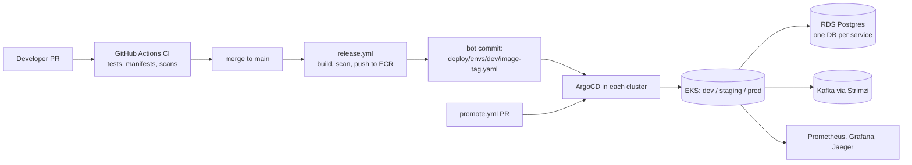

# MicroKart: DevOps Handbook

Hand-off from development to operations. This document is the single path from an empty AWS account to a running, monitored, GitOps-managed platform, plus day-2 operations.

## 1. What you are operating



| Layer | Choice | Where defined |
|---|---|---|
| Cloud | AWS, region `ap-south-1` (change in tfvars + workflows) | `terraform/` |
| Cluster | One EKS cluster per environment (own VPC) | `terraform/main.tf` |
| Registry | ECR, one immutable-tag repo per service, shared by all envs | `terraform/bootstrap/` |
| Database | One RDS PostgreSQL instance per env, one database per service | `terraform/main.tf`, `charts/microkart/templates/db-init-job.yaml` |
| Messaging | Kafka (KRaft) by Strimzi in the `kafka` namespace | `deploy/platform/config/` |
| Secrets | AWS Secrets Manager, synced by External Secrets Operator (IRSA) | `terraform/main.tf`, `charts/microkart/templates/secrets.yaml` |
| Delivery | GitOps: ArgoCD app-of-apps, one root app per cluster | `deploy/argocd/` |
| Packaging | One Helm chart for all services, driven by `services.yaml` | `charts/microkart/` |
| CI/CD | GitHub Actions with OIDC (no static AWS keys) | `.github/workflows/` |
| Observability | kube-prometheus-stack, Jaeger all-in-one, OpenTelemetry in every service | `deploy/platform/`, `charts/microkart/templates/monitoring.yaml` |

**Environments.** `dev` auto-deploys every merge to `main`. `staging` and `prod` change only through a promotion PR (`promote.yml`). In `prod` ArgoCD does not auto-sync: after the PR merges, an operator presses Sync (`deploy/envs/prod/apps.yaml`).

**Image versioning.** All services are built from one commit and share one tag: the first 12 characters of the git SHA. A promotion moves that exact tag, so what ran in staging is what runs in prod.

## 2. Verification status (read this first)

| Area | Status |
|---|---|
| Application: unit tests and 15-check end-to-end smoke test | Run and passing (local bus + SQLite) |
| Helm charts (microkart, platform-config, argocd apps): `helm lint` and render for dev, staging, prod, local | Run and passing |
| Rendered manifests validated with kubeconform against Kubernetes 1.31 **and CRD schemas** (ExternalSecret, ServiceMonitor, PrometheusRule, Kafka, Argo Application) | Run and passing, 0 skipped |
| GitHub workflows: `actionlint` | Run and passing |
| Terraform: `fmt` and HCL syntax | Run and passing |
| Terraform `validate` / `plan` / `apply` | **Not run**: the provider registry was unreachable from my sandbox. CI runs `terraform validate` on every PR; expect small fixes on first plan |
| Docker images, `docker compose up`, kind deployment | **Not run** (no Docker daemon here). `make kind-up` + `make k8s-smoke` is your first end-to-end gate |
| ArgoCD sync, Strimzi, External Secrets, ingress, cert-manager on a real cluster | **Not run**. Chart versions are pinned from memory of what exists; confirm each with `helm search repo` before first sync |
| Postgres and Kafka code paths of the app | **Not run** against real servers (SQLite + local bus were); portable SQL and a thin aiokafka wrapper |

Treat the first bring-up of `dev` as the real test. Section 4 is ordered so each step proves the previous one.

## 3. Prerequisites

- AWS account with admin rights for the one-time bootstrap; a Route53 zone (or DNS you control) for the hostnames in `deploy/envs/*/microkart.yaml`.
- A GitHub repository for this code. Replace `YOUR_ORG` in `deploy/argocd/apps/values.yaml` and `.github/CODEOWNERS`.
- Tools: `terraform` (or `tofu`) >= 1.6, `aws` CLI v2, `kubectl`, `helm` 3.x, `docker`, `kind` (local test), `envsubst`, `python` 3.12.
- Placeholders to replace before going live: `YOUR_ORG`, `*.example.com` hostnames, `platform@example.com` (Let's Encrypt contact), the account ID `000000000000` (overwritten automatically by step 4.4), `REPLACE_WITH_STATE_BUCKET` in `terraform/envs/backend-*.hcl`.

## 4. Day-0 setup, step by step

### 4.1 Prove the chart locally (no AWS)

```bash
make validate        # static checks: charts render and match K8s/CRD schemas
make kind-up         # kind cluster + in-cluster Postgres/Kafka + the real chart
make k8s-smoke       # the 15-check end-to-end test through the gateway
make kind-down
```

### 4.2 Bootstrap the AWS account (once)

```bash
cd terraform/bootstrap
terraform init
terraform apply -var github_repo=YOUR_ORG/microkart
terraform output          # note: state_bucket, ecr_registry, ci_ecr_role_arn, ci_terraform_role_arn
```

This creates the state bucket and lock table, all ECR repos (immutable tags, scan on push, keep last 50), the GitHub OIDC provider, and two CI roles. Image pushes are only allowed from `main`; Terraform runs only from pull requests and approved GitHub Environments.

Then put the real bucket name into `terraform/envs/backend-{dev,staging,prod}.hcl`.

### 4.3 Configure GitHub

1. Settings, Secrets and variables, Actions, **Variables**: `AWS_ECR_ROLE_ARN` = `ci_ecr_role_arn`, `AWS_TF_ROLE_ARN` = `ci_terraform_role_arn`.
2. Settings, Environments: create `dev`, `staging`, `prod`. Add **required reviewers** on `staging` and `prod` (they gate `terraform apply`).
   Until `AWS_ECR_ROLE_ARN` exists, the `release` build job is **skipped** (not failed), so a fresh push stays green.
3. Branch protection on `main`: require the `ci` checks and Code Owner review. Allow the CI bot to push `deploy/envs/dev/image-tag.yaml` (bypass rule or a dedicated deploy token) since `release.yml` commits straight to `main`.

### 4.4 Create the environment (repeat per env, starting with dev)

```bash
cd terraform
terraform init -backend-config=envs/backend-dev.hcl
terraform plan  -var-file=envs/dev.tfvars
terraform apply -var-file=envs/dev.tfvars        # ~20-30 min (EKS + RDS)
cd ..
python scripts/ops/tf_to_values.py dev           # writes deploy/envs/dev/generated.yaml + external-secrets.yaml
git add deploy/envs/dev && git commit -m "dev: wire terraform outputs" && git push
```

Set `admin_role_arns` (your SSO admin role) and `api_public_access_cidrs` (your VPN/office IP) in the tfvars first, otherwise the API endpoint is private-only and you cannot reach it. The apply creates: VPC (3 AZ), EKS with managed node group and add-ons (CoreDNS, kube-proxy, VPC CNI, EBS CSI), RDS, two Secrets Manager secrets (`microkart/<env>/db`, `microkart/<env>/app` with a generated JWT secret), and the IRSA role for External Secrets.

You can also run it from CI: Actions, **terraform**, Run workflow, pick the environment (it waits for the Environment approval).

### 4.5 Hand the cluster to GitOps

```bash
eval "$(terraform -chdir=terraform output -raw kubeconfig_command)"
REPO_URL=git@github.com:YOUR_ORG/microkart.git GIT_DEPLOY_KEY_FILE=~/.ssh/microkart_deploy \
  scripts/ops/bootstrap-cluster.sh dev
kubectl -n argocd get applications -w
```

`GIT_DEPLOY_KEY_FILE` is a read-only deploy key and is only needed for a private repo. Sync order is enforced with waves:

| Wave | What | Why first |
|---|---|---|
| 0 | ingress-nginx, cert-manager, external-secrets, kube-prometheus-stack, strimzi, metrics-server | operators and CRDs |
| 1 | `platform-config`: ClusterSecretStore, ClusterIssuer, gp3 StorageClass, Kafka cluster + topics, Jaeger | needs the CRDs from wave 0 |
| 2 | `microkart`: ExternalSecrets (-2), DB-init Job (-1), then Deployments | needs secrets, Kafka, and databases |

Expect the first sync to take 10-15 minutes and a few retries; Kafka and cert-manager CRDs settle last.

### 4.6 DNS and TLS

```bash
kubectl -n ingress-nginx get svc ingress-nginx-controller -o jsonpath='{.status.loadBalancer.ingress[0].hostname}'
```

Create CNAME records for `api.dev...` and `grafana.dev...` pointing at that NLB hostname. cert-manager then issues certificates via Let's Encrypt (HTTP-01). External-DNS is not included; add it if you want records managed automatically.

### 4.7 Verify

```bash
scripts/ops/k8s-smoke.sh                  # via port-forward, no DNS needed
python tests/smoke_test.py https://api.dev.microkart.example.com   # through the real ingress
kubectl -n microkart get pods,hpa,pdb
kubectl -n kafka get kafka,kafkatopic
```

Then repeat 4.4 to 4.7 for `staging` and `prod`.

## 5. CI/CD

| Workflow | Trigger | Does |
|---|---|---|
| `ci.yml` | every PR, push to main | pytest, e2e smoke, generated-files check, `validate.sh` (helm + kubeconform), `terraform validate`, Trivy config scan (pinned to `trivy-action@0.35.0` / Trivy `v0.69.3`, known-safe after the March 2026 supply-chain incident; accepted findings in `.trivyignore`), builds every image |
| `release.yml` | push to `main` (code changes) | builds every service, pushes `<sha12>` to ECR, Trivy-scans each image (fails on fixable CRITICAL), commits the tag to `deploy/envs/dev/image-tag.yaml` |
| `promote.yml` | manual | opens a PR moving the tag dev to staging, or staging to prod, after confirming the image exists in ECR |
| `terraform.yml` | PR touching `terraform/`; manual apply | plan for all envs on PR; apply behind Environment approval |

**Release path:** merge, wait for `release`, ArgoCD deploys dev, run smoke, run `promote` (dev to staging), merge PR, ArgoCD deploys staging, then `promote` (staging to prod), merge PR, **Sync** `microkart` in the prod ArgoCD.

**Rollback:** revert the promotion commit (or set the previous tag in `deploy/envs/<env>/image-tag.yaml`) and sync. Images are immutable, so the old tag is still in ECR. Application state is JSON documents plus an outbox, so there are no schema migrations to reverse today. Roll back infra changes with `terraform apply` of the previous commit.

**Emergency stop for a bad deploy in prod (no git):** `argocd app rollback microkart` or `kubectl -n microkart rollout undo deploy/<name>`. Argo will show OutOfSync; follow up with the git revert.

## 6. Configuration and secrets

- Non-secret config: `deploy/envs/<env>/microkart.yaml` (hostnames, replicas, resources, per-service autoscaling in `overrides`).
- Secrets never live in git. Secrets Manager holds `microkart/<env>/db` (host, username, password) and `microkart/<env>/app` (JWT_SECRET). External Secrets refreshes them hourly into Kubernetes Secrets `microkart-db` and `microkart-app`.
- Pods read secrets as environment variables at start, so **a rotated secret needs a restart**: `kubectl -n microkart rollout restart deploy`.
- **JWT rotation** invalidates every issued token (users must log in again): update the secret value in Secrets Manager, then restart.
- **DB password rotation:** `terraform apply -replace=random_password.db -var-file=envs/<env>.tfvars` (updates RDS and the secret), wait for the ExternalSecret refresh (`kubectl -n microkart annotate externalsecret microkart-db force-sync=$(date +%s) --overwrite`), then restart.
- Adding a service: set it `implemented` in `services.yaml`, `make generate`, commit. The chart, the ECR repo (Terraform bootstrap), the CI matrix and the databases all follow from that one file. A new ECR repo needs `terraform apply` in `bootstrap` before the first release.

## 7. Observability

- **Metrics:** every service exposes `/metrics`; the `microkart` ServiceMonitor scrapes all of them. Key series: `http_requests_total`, `http_request_duration_seconds`, `events_published_total`, `events_consumed_total{result=ok|duplicate|dead_letter}`.
- **Dashboards:** Grafana at `https://grafana.<env>.microkart.example.com`. The chart's default admin password is `prom-operator`: change it immediately (`grafana.admin.existingSecret`) and wire SSO. The **MicroKart Overview** dashboard is provisioned from the chart.
- **Traces:** Jaeger (`jaeger-query` in `observability`): `kubectl -n observability port-forward svc/jaeger-query 16686`. Storage is in memory, so traces vanish on restart; use Tempo or OpenSearch if you need retention.
- **Logs:** not centralised yet (see gaps). Use `kubectl logs -l app.kubernetes.io/part-of=microkart --tail=100 --prefix`. Every line carries `rid=<request-id>`, and the gateway propagates it across services and into events (`request_id`), so one grep follows an order end to end.

### Alerting

Rules ship with the chart (`monitoring.yaml`). Alertmanager has a null receiver until you add a real one. Example for Slack:

```bash
kubectl -n monitoring create secret generic alertmanager-slack --from-literal=url='https://hooks.slack.com/services/...'
```

```yaml
# deploy/envs/<env>/kube-prometheus-stack.yaml
alertmanager:
  alertmanagerSpec:
    secrets: [alertmanager-slack]
  config:
    route:
      receiver: slack
      routes:
        - matchers: ['severity="page"']
          receiver: slack
    receivers:
      - name: slack
        slack_configs:
          - api_url_file: /etc/alertmanager/secrets/alertmanager-slack/url
            channel: '#microkart-alerts'
            send_resolved: true
```

(Create the secret per cluster via your secrets process, or add it to Secrets Manager and an ExternalSecret.)

## 8. Alert runbooks

**MicrokartHighErrorRatio** (page): more than 5% of a service's requests return 5xx.
1. Grafana, MicroKart Overview: which service, since when? Did it follow a deploy (`kubectl -n argocd get app microkart`)? If yes, roll back (section 5).
2. `kubectl -n microkart logs deploy/<svc> --tail=200` and look for `-> 5`. A 503 or 504 on a call means its upstream is down: follow the chain (gateway to order to cart to menu).
3. 500s from a stateful service usually mean the database: check RDS CPU, connections and free storage in CloudWatch, and `kubectl -n microkart logs deploy/<svc> | grep -i "database not ready"`.

**MicrokartHighLatencyP95** (ticket): p95 above 1s for 10 minutes. Check CPU throttling and HPA (`kubectl -n microkart get hpa`), and whether metrics-server is healthy (`kubectl top pods -n microkart`). Cart calls Menu once per line item, so a slow Menu multiplies; open a trace in Jaeger.

**MicrokartDeadLetterEvents** (page): a handler failed 3 times and the event went to topic `dlq`.
```bash
kubectl -n kafka exec microkart-dual-role-0 -- /opt/kafka/bin/kafka-console-consumer.sh \
  --bootstrap-server localhost:9092 --topic dlq --from-beginning --max-messages 5
```
The record contains `service`, `topic` and the original `event`. Fix the cause (usually a bug or a bad payload), deploy, then re-publish the inner `event` to its original topic with the same `id`. Consumers record an event id only after success, so a failed event is safe to replay.

**MicrokartNoEventsPublished** (page): orders are accepted (202) but Payment consumes nothing. The outbox relay or Kafka is stuck.
1. `kubectl -n kafka get kafka,pods`; Kafka must be Ready.
2. Orders are not lost: unpublished events wait in each service's `outbox` table and the relay retries every second once the broker is back.
3. To replay events (for example after a Kafka rebuild): in the service database run `UPDATE outbox SET published=0 WHERE created > extract(epoch from now() - interval '2 hours');`. Duplicates are harmless because every consumer is idempotent.

**MicrokartPodCrashLooping / DeploymentUnavailable / TargetDown:** `kubectl -n microkart describe pod <pod>` then `logs --previous`. Common causes: `CreateContainerConfigError` means the secret is missing (check `kubectl -n microkart get externalsecret`); `database "x" does not exist` means the DB-init Job failed (`kubectl -n microkart logs job/microkart-db-init`); readiness failing at startup means Kafka or RDS is unreachable.

## 9. Security posture

Implemented:
- GitHub to AWS via OIDC; the image-push role can only be assumed from `main`. No static AWS keys.
- Immutable ECR tags, scan on push, plus Trivy gates on config (PR) and images (release).
- Pods: non-root numeric UID, read-only root filesystem, all capabilities dropped, seccomp `RuntimeDefault`, no service account token. The namespace enforces Pod Security `restricted`.
- NetworkPolicies: default-deny ingress; only the ingress controller reaches the gateway; Prometheus can scrape.
- Only the gateway is internet-facing. Payment is not routable through it (`ROUTABLE` allow-list). The gateway strips client-supplied `x-user-id`.
- Secrets in Secrets Manager via IRSA scoped to exactly two secrets; RDS in private subnets, encrypted, reachable only from node security group.
- Cluster API private by default; public access only for listed CIDRs; access via EKS access entries.

Known gaps (decide and schedule):
- **Internal calls are trusted.** Services accept `x-user-id` from any pod in the namespace; NetworkPolicy is the only protection. Add a mesh with mTLS (Linkerd/Istio) or signed service tokens before handling real data.
- Kafka traffic is plaintext inside the cluster; Strimzi supports TLS and SASL listeners.
- `AdministratorAccess` on the Terraform CI role; narrow it once the stack settles.
- No WAF in front of the NLB, no egress policies.
- Rate limiting is in the gateway process and per replica, not global.

## 10. Capacity and scaling

- Pods scale with HPAs (enabled for the hot services in staging and prod via `overrides`) and need **metrics-server** (deployed as a platform app).
- **Nodes do not auto-scale yet.** The managed node group has min/max, but nothing adds nodes when pods go Pending. Add Karpenter or cluster-autoscaler (needs IRSA and ASG tags) before relying on HPAs under load.
- Kafka topics have 3 partitions, so at most 3 replicas of a service consume in parallel. Raise `kafka.partitions` in `deploy/envs/<env>/platform-config.yaml` (partitions can only increase) before scaling past 3.
- Every replica runs the outbox relay: duplicates are possible and harmless (idempotent consumers) but cost a little throughput.
- App-level limit for the developer backlog: the document store filters lists in Python (`Store.list`), fine for demo volumes, not for large tables. Real per-service schemas and indexes are a Phase 2b task.

## 11. Backup and disaster recovery

| Component | Protection | Recovery |
|---|---|---|
| RDS | Automated backups (7/14 days), point-in-time restore, Multi-AZ in prod, deletion protection in prod | Restore to a new instance, update `microkart/<env>/db` host, restart pods |
| Kafka | 3 brokers, replication 3, min ISR 2 in staging/prod, persistent gp3 volumes | Broker loss is automatic; full loss: rebuild, then replay outboxes (section 8) |
| Secrets | Secrets Manager (7-day recovery window in prod) | Terraform recreates generated values; rotate after |
| Cluster | Everything is in git and Terraform | `terraform apply` + `bootstrap-cluster.sh`: expect around an hour to a fully working environment |

Run a restore drill for RDS and a "delete the namespace" drill in staging before go-live, and record the timings.

## 12. Cost drivers

EKS control plane, NAT gateways (one in dev/staging, one per AZ in prod), worker nodes, RDS (Multi-AZ doubles it in prod), NLB, CloudWatch logs, ECR storage, EBS for Kafka and Prometheus. Dev uses spot nodes and a single NAT to stay cheap. Tear dev down when idle: delete the ArgoCD root app (prunes workloads and load balancers), then `terraform destroy -var-file=envs/dev.tfvars`. Prod has `deletion_protection` on RDS, so destroy will refuse by design.

## 13. Day-2 checklist

- Daily: Grafana overview, open alerts, ArgoCD apps Healthy and Synced.
- Weekly: Dependabot/Renovate PRs for chart versions in `deploy/argocd/apps/values.yaml` and Terraform module versions; review Trivy findings; check RDS storage growth.
- Monthly: restore drill, rotate JWT secret, review IAM and CODEOWNERS, EKS version upgrade plan (`cluster_version`, one minor at a time, dev first).

## 14. Repository map

```
services.yaml                  single source of truth for all services
services/<name>/main.py        application code (FastAPI)
common/microkart_common/       shared lib: db/outbox, events, metrics, tracing
docker/Dockerfile              one parameterised image build
charts/microkart/              Helm chart (deployments, HPA, PDB, netpol, ingress, secrets, alerts, dashboard)
deploy/argocd/                 app-of-apps chart + root Application template
deploy/platform/               upstream chart values + platform-config chart (Kafka, issuer, secret store, Jaeger)
deploy/envs/<env>/             per-environment values; image-tag.yaml is written by CI
deploy/local/                  kind environment
terraform/bootstrap/           state, ECR, GitHub OIDC (once per account)
terraform/                     per-env VPC, EKS, RDS, secrets, IRSA (envs/*.tfvars)
scripts/ops/                   validate, bootstrap-cluster, kind-up, k8s-smoke, tf_to_values
.github/workflows/             ci, release, promote, terraform
```
